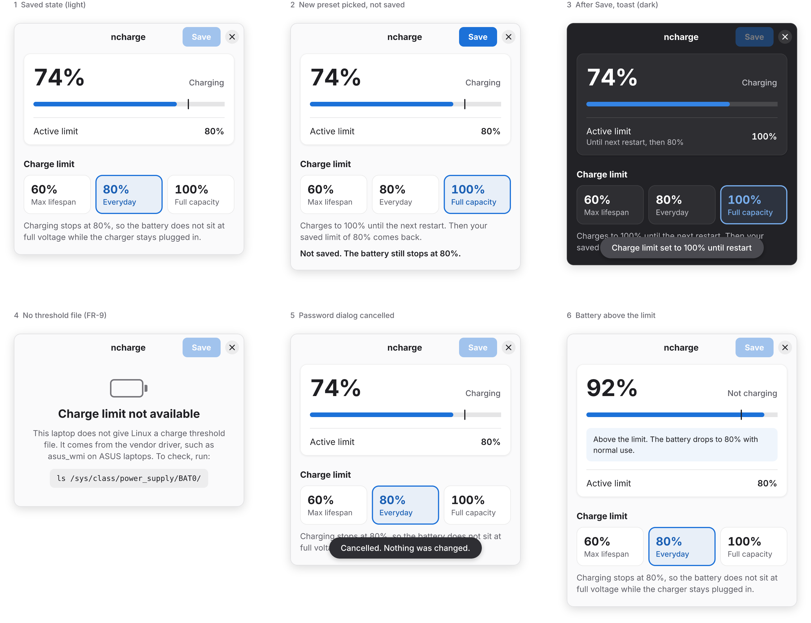

# ncharge

[](#)
[](#)
[](#)
[](https://creativecommons.org/licenses/by-nc/4.0/)
[](#)

**Lightweight, native Battery Charge Limit Manager for Linux.**  
Extend your laptop battery health by stopping charge at 80% (or 60%) — without heavy background daemons, without masking power profiles, and with bulletproof persistence across ASUS EC resets.



---

## Why ncharge?

Lithium-ion laptop batteries degrade significantly faster when kept at 100% state-of-charge under continuous AC power. While Linux kernels expose hardware charge thresholds directly via sysfs:

```
/sys/class/power_supply/BAT0/charge_control_end_threshold
```

ASUS Embedded Controllers (and many OEM devices) **reset this threshold back to 100 on every power cycle**. Existing Linux solutions are often overcomplicated:

| Tool | Drawback for simple charge limiting |
|---|---|
| **TLP** | Full system power tuning suite; conflicts with and requires masking `power-profiles-daemon` |
| **asusctl** | Heavy D-Bus daemon targeted primarily at ROG/TUF gaming laptops; overkill for VivoBook/ZenBook |
| **GNOME Extensions** | Limited to GNOME Shell sessions; can break across major GNOME upgrades |
| **Manual Scripts** | Effective, but lacks a clean user-friendly GUI to temporarily charge to 100% when travelling |
| **ncharge** | **Zero background daemons (0 MB RAM idle).** Single-purpose, native Adwaita UI, 3-layer boot & sleep persistence |

---

## Key Features

- **Native GNOME / Adwaita Design:** 100% pixel-accurate Adwaita layout with spring/jelly physics and automatic dark/light mode.
- **Three Clear Presets:**
  - `60% (Max lifespan)`: For desk setups permanently connected to AC.
  - `80% (Everyday)`: Balanced daily protection (matches MyASUS Battery Health Charging).
  - `100% (Full capacity)`: Smart `--once` mode that charges to full for travel, then automatically reverts back to your saved limit on the next restart.
- **Robust Persistence:**
  - **Boot:** Systemd oneshot service with bounded retry to handle late-loading vendor modules (`asus_nb_wmi`).
  - **Sleep/Resume:** Dedicated systemd sleep hook ensuring hibernate and suspend do not revert to 100%.
- **Zero Background Resource Usage:** No daemon running in the background. Opens in `< 0.15s`, uses `< 50 MB RAM` when open, and releases memory completely upon closing.

---

## Installation

### Prerequisites

- Linux with kernel supporting `charge_control_end_threshold` (e.g. ASUS VivoBook/ZenBook/ROG, ThinkPad, LG Gram).
- `pkexec` (standard polkit installed on Ubuntu, Zorin OS, Fedora, Debian).

### Build from Source

```bash
# 1. Clone the repository
git clone https://github.com/rizqinrr/ncharge-zorin-os.git
cd ncharge-zorin-os

# 2. Build release binaries as normal user
cargo build --release

# 3. Install binaries, systemd service, sleep hooks, and desktop icons
sudo bash packaging/install.sh
```

Once installed, **ncharge** will be available directly in your Application Drawer / App Menu!

### Uninstall

```bash
sudo bash packaging/uninstall.sh
```
*The uninstaller cleans up all binaries, hooks, and services, and will prompt you whether to keep or remove `/etc/ncharge.conf`.*

---

## CLI Usage (`ncharge-apply`)

`ncharge` includes a standalone, shell-injection-safe backend helper:

```bash
# Check battery status & hardware threshold
ncharge-apply status

# Apply persistent limit (requires root)
sudo ncharge-apply apply 80

# Apply temporary limit until next reboot
sudo ncharge-apply apply 100 --once

# Restore limit from config (used by systemd & sleep hooks)
sudo ncharge-apply restore
```

---

## Technical Architecture

```
┌────────────────────────────┐   pkexec (polkit)     ┌──────────────────────────────────┐
│  ncharge (GUI, Rust)       │ ────────────────────▶ │ ncharge-apply (helper, root)     │
│  gtk4-rs + libadwaita-rs   │  apply <N> [--once]   │ writes sysfs + /etc/ncharge.conf │
└────────────────────────────┘                       │ (or /run/ncharge.override)       │
        │ direct read-only sysfs                     └──────────────────────────────────┘
        ▼                                                             ▲
 /sys/class/power_supply/BAT*                        • ncharge-apply.service (boot)
        │                                            • /usr/lib/systemd/system-sleep/ncharge (resume)
        ▼
 Embedded Controller (EC) via kernel driver
```

---

## License

This project is licensed under **Creative Commons Attribution-NonCommercial 4.0 International (CC BY-NC 4.0)**.  
You are free to share and adapt the material for personal and non-commercial purposes with appropriate attribution. **Commercial use or resale is strictly prohibited.**

See [LICENSE](LICENSE) for the full license text.
